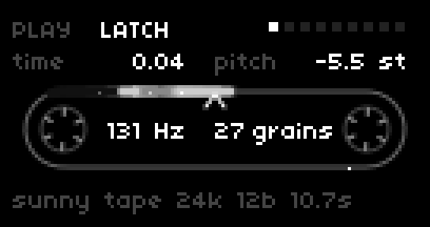
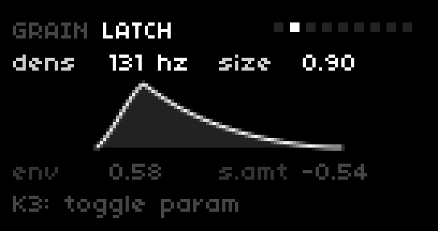
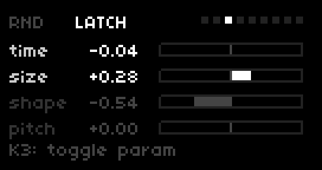
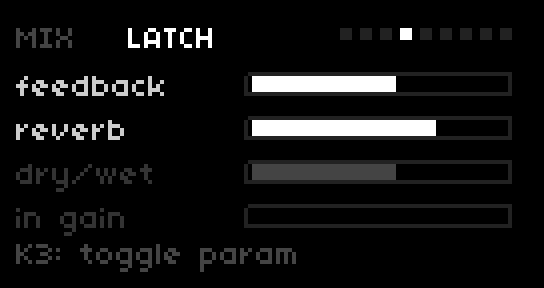
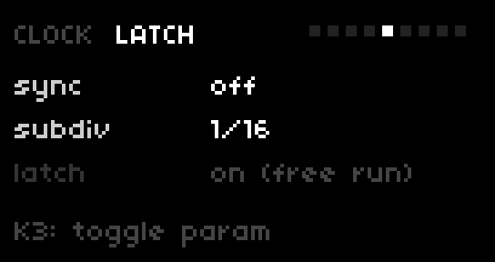
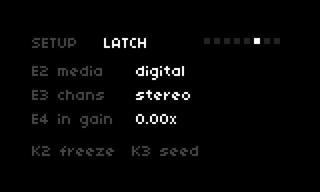
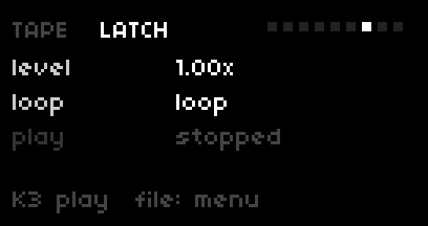
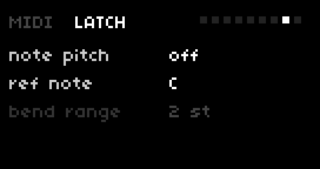
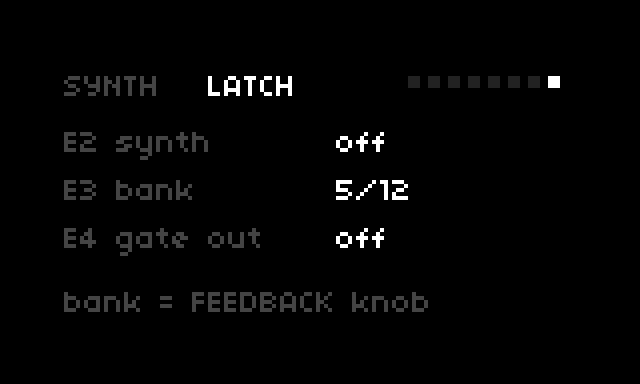

# beads for norns

[Mutable Instruments Beads](https://pichenettes.github.io/mutable-instruments-documentation/modules/beads/)
for [norns](https://monome.org/docs/norns/).

The granular cloud, the multitap delay / tape mode, freeze, reverb and the
four media characters all run on the module's own firmware code from
[pichenettes/eurorack](https://github.com/pichenettes/eurorack), vendored
under `ugens/eurorack-beads/` and wrapped as a SuperCollider UGen in the
same way as v7b1's [mi-UGens](https://github.com/v7b1/mi-UGens) (used by
[mi-eng](https://github.com/okyeron/mi-eng)). The norns side — rate
conversion, the input stage, the interface — lives in the wrapper.

<table>
<tr>
<td><br><b>PLAY</b> — live view of every grain on the loop</td>
<td><br><b>GRAIN</b> — density / size / shape + envelope</td>
<td><br><b>RND</b> — the four attenurandomizers</td>
</tr>
<tr>
<td><br><b>MIX</b> — feedback / reverb / dry-wet / gain</td>
<td><br><b>CLOCK</b> — sync to norns BPM</td>
<td><br><b>SETUP</b> — media / channels</td>
</tr>
<tr>
<td><br><b>TAPE</b> — file player into the input</td>
<td><br><b>MIDI</b> — pitch CV via notes</td>
<td><br><b>SYNTH</b> — wavetable synth mode</td>
</tr>
</table>

## Layout

```
beads.lua               norns script (9 pages, no alt layers)
lib/Engine_Beads.sc     CroneEngine wrapper (commands + polls + tape player)
lib/BeadsUGen.sc        sclang class for the UGen (compiled from ~/dust)
lib/beads_engine.lua    param registration
lib/fileselect.lua      vendored norns file browser (include can't see core lua/lib)
ugens/beads_ugen.cpp    SC UGen: rate adapters + GainControl + beads::Processor
ugens/eurorack-beads/   vendored beads dsp + stmlib subset (MIT, pristine)
ugens/sc-plugin-headers/ vendored SC plugin headers (3.13.0)
deploy.sh               dev flow: sync to the device, build + install
```

## Install (from GitHub, on the norns itself)

The script folder must be named `beads` (norns matches the folder name to
the main lua file), so clone with a target directory:

```sh
git clone https://github.com/schrab/beads-norns ~/dust/code/beads
cd ~/dust/code/beads/ugens
make && make install
sudo systemctl restart norns-jack norns-sclang norns-main
```

`make install` copies the compiled `BeadsUGen.so` into
`/usr/local/lib/SuperCollider/plugins/` (sudo; the only dir the norns
scsynth scans for plugins). The sclang classes compile straight from
`~/dust` — nothing else to install. Requires `g++` and `make` on the
norns (`sudo apt-get install -y build-essential` if missing; the stock
image usually has them). The UGen assumes scsynth at 48 kHz (norns
default). Then select `beads` from SELECT.

Upgrading: `cd ~/dust/code/beads && git pull && cd ugens && make &&
make install` + restart. Removing: delete `~/dust/code/beads` and
`/usr/local/lib/SuperCollider/plugins/BeadsUGen.so`.

## Deploy (from the dev machine)

`./deploy.sh [host]` (default host `fates`) tars the tree to
`~/dust/code/beads`, rebuilds `BeadsUGen.so` on-device, installs it to
`/usr/local/lib/SuperCollider/plugins/`, and removes any legacy
`Extensions/BeadsUGens` copy. Then restart the
three units explicitly — `systemctl restart norns-jack norns-sclang
norns-main` (restarting `norns.target` alone does NOT restart bound
services). Set `clean_shutdown = true` in `~/dust/data/system.state` before
restarting if the script should resume at boot. Lua-only changes still need
the restart (or re-selecting the script), but no rebuild.

## Controls

| input | action |
|---|---|
| E1 | page |
| E2 / E3 | the page's **active pair** (two of its parameters) |
| K3 tap | toggle the active pair: (1,2) ↔ (3,4) on 4-param pages, (1,2) ↔ (3) on 3-param pages |
| E4 | the page's last parameter (4-encoder hardware) |
| K2 | freeze — PLAY page only |
| K3 | seed — PLAY page only (TAPE page: K3 = play/stop) |
| K1 hold + K2 | cycle the buffer quality (media) — PLAY page |
| K1 hold + K3 | toggle the seed latch — PLAY page |

The active rows are bright, the others dimmed; both pairs stay on screen
(GRAIN shows one pair above and one below the envelope). K1 is the norns
system menu key on a short press; a K1 **long hold** (≥ 0.25 s) is passed
to the script and arms the PLAY-page combos above.

Seed is also a param (**SETUP > seed (hold)**, momentary): hold K3 on it in
the PARAMS menu, or MIDI-map it (PARAMS > EDIT) to a CC — CC high holds the
seed gate open, CC zero closes it, exactly like the button. Freeze is a
param too.

**PLAY page is a live view of the granulator** (the record head stays
fixed — tape frame): every grain is drawn at its true position and size
against the loop, and they move. The geometry mirrors `DelayGrain` exactly:
each grain's **material span** is `pitch_ratio × duration` seconds of tape,
glued to the loop (it recedes with the tape like the splice does); forward
grains extend toward newer material, reverse grains (SIZE < 1/3, dimmed)
toward older; a bright stylus pixel sweeps the span at the playback ratio
(pitch 0 = riding the tape, pitch up = chasing the head, pitch down =
sliding away). Spawns re-roll time/size/pitch/shape through the same
per-trigger randomization as the module's attenurandomizers, with the DSP's
head-crossing trims and STOP policy (a grain that reaches the head dies).
Brightness follows the grain's envelope (shape). Inside the loop the
**grain rate and live count** are printed (`131 Hz  32 grains`) — the
number of grains actually flying right now, 0 whenever the seed gate is
closed, saturated at the DSP's 32-grain pool. Every text element is
anchored at a fixed position, so nothing wiggles as values change. Two 6-notch reels sit in the end caps, phase-locked to the splice:
one rotation per loop pass, notch up when the splice passes the head, and
everything stops on freeze. Grains only appear when the gate is open (latch
on, or K3 held), the density deadband taps spawn a grain per press, and
media changes clear the view (the buffer resets). In delay mode (SIZE max)
the display shows the static read position with regen echoes.

Pages: **PLAY** (time, pitch, pitch amount — tape-loop view), **GRAIN**
(density, size, shape, shape amount — grain envelope preview), **RND**
(all four attenurandomizers: time/size/shape/pitch amounts, bipolar bars),
**MIX** (feedback, reverb, dry/wet, input gain), **CLOCK** (sync to norns
BPM, subdivision, seed latch), **SETUP** (media, channels), **TAPE** (file
player: level, loop/once, play/stop), **MIDI** (note pitch, reference
note, bend range), **SYNTH** (wavetable synth mode, bank, gate output).

Every control steps exactly one display increment per encoder detent
(pitch 0.1 st, input gain 1 setting, amounts 0.02, the 0–1 params 0.005).

**MIDI note pitch** (MIDI page) stands in for the hardware PITCH CV jack:
with it on, notes transpose the granulator by `note − reference` semitones
(last-note priority; the last note holds on release, like a CV keyboard
holding its voltage; pitch bend adds its range on top). PLAY's **pitch
amount** is the CV depth — exactly the module's PITCH AMOUNT attenuverter:
0 = CV ignored, positive = depth, negative = CV-driven randomization
(enabling note pitch auto-raises a zero amount to 1). Any MIDI device
assigned in SYSTEM > DEVICES > MIDI is picked up; the header shows NOTE
while a note is held.

**Wavetable synth mode** (SYNTH page) is the module's no-input mode,
switched manually (norns cannot sense unpatched jacks, so the hardware's
10-second auto-activation has no faithful equivalent). It runs Plaits'
raw wavetable banks through the same granular engine at native 48 kHz:
FEEDBACK becomes a 12-bank wavetable selector (SYNTH E3 shows the bank),
DRY/WET balances the continuous oscillator against the granularized
layer, the media switch becomes the output resolution, DENSITY/SIZE/
SHAPE/TIME keep their meanings, PITCH CV folds into the root note while
the pitch attenurandomizer pure-randomizes (hardware behavior), and
FREEZE halts the grain envelopes and new grains. The header shows SYN.

**Gate output** (SYNTH E4) is the hardware's output-gate flag: the left
output carries the mono sum and the right output emits the grain trigger
gate (usable in both modes).

**Delay-mode density** reads as the hardware's ratio ring in all delay
mode states: `1/16 … 1/1` binary counterclockwise, `1/2, 1/3, 1/4, 1/6,
1/8, 1/10, 1/12, 1/16` clockwise — the DSP's exact 20-slot kRatio table.
(Clock sync / tapping subdivides the tapped interval; the free-running
latched path sweeps the interval continuously, but the label follows the
printed ring.) The CLOCK page subdivision macro targets the exact kRatio
slot centers.

The AMOUNT knobs mirror the module's attenurandomizers and pass through the
hardware attenuverter law (center dead zone, expanding curve): positive
sprays the parameter toward random per grain (pitch: ±24 st), negative peaks
values near the knob, zero (±0.06) = off. Pitch amount sits on PLAY next to
pitch.

**Clock sync** (CLOCK page): the script sends one seed pulse per
norns-system beat. With the **seed latch on** the pulses clock the DSP
like the hardware's clocked SEED jack — delay mode (SIZE to max) locks
its tempo to bpm × subdivision (1/16…1…×16 — the subdivision walks the
same DSP ratio table the density knob uses when clocked, so GRAIN's
density and CLOCK's subdiv stay consistent), granular mode becomes a
clocked divider/probability. With the **latch off**, every beat fires
one seed trigger instead — the hardware's patched-SEED trigger behavior
(each pulse spawns grains, nothing between beats). The seed button (K3)
stays live in both modes.

**Tape player** (TAPE page) feeds an audio file straight into the
granulator's input — summed with the hardware line-in, at any input gain,
recordable into the loop like a tape deck plugged into the module. Load a
file from the menu via **PARAMS > TAPE > load tape file** (the browser
starts in `~/dust/audio` so all sample folders are reachable; TAPE
recordings live one level up in `~/tape`) — it loads and starts playing.
**K3** on the page toggles play/stop (also a param, so MIDI-mappable),
**E3** once/loop, **E2** level. Loading another file while playing
switches live. This is the buffer-feed path norns' own TAPE menu doesn't
offer (TAPE playback goes to the output mix only — the script's input is
the line-in copy, there is no tape→script path in norns' mixer). The file
isn't persisted in psets (norns 3.0 has no file param type); level, loop
and play are.

All controls are norns params → psets, MIDI mapping (PARAMS > EDIT), and
the engine commands are available to other scripts and processes over OSC
(`/command/buffer_load` with a path string, `/command/buffer_play`,
`/command/clock`, … — the same messages the script itself sends).

## Fidelity notes

- **Sample rates.** On hardware the codec is re-clocked per media and the
  engines run at 24 kHz (scorched cassette), 32 kHz (cold digital) and
  48 kHz (bright digital; sunny tape self-decimates 2:1 behind 48 kHz
  frames). norns' scsynth runs at a fixed 48 kHz, so scorched/cold are
  resampled with the same stmlib polyphase converters the firmware uses
  internally (2:1, and 3:2 as up-2/down-3), clocked in aligned superblocks
  (64/192 host samples) so the integer ratios chain exactly. This costs
  ~1.5 ms of extra latency on those two media only; loop lengths match the
  hardware exactly (16 / 10.7 / 8 / 4 s stereo, doubled in mono).
- **Input stage.** The hardware's `GainControl` stage is ported: input
  gain 0 = auto-gain (the GAIN knob fully CCW), 1–255 = the hardware
  manual law (s/255)⁴ over 1–40×, with the per-media soft clipping
  (scorched cassette always soft-clips, sunny tape dynamically). Turning
  the gain up drives the tape engines exactly like overdriving the
  module's inputs.
- **Seed latch defaults ON** at script start (the module boots unlatched;
  unlatched + density in the deadband is silent, which reads as "broken"
  on norns). Everything else about latch/clock semantics follows the
  firmware: LOCKED + external clock = clocked divider / synced delay
  tempo; with nothing patched the firmware passes a NULL seed input and
  the button state alone drives gating and tap tempo.
- **Parameter granularity.** All controlspecs pass an explicit `quantum`
  (see Dev notes) so encoder detents match the display, and the AMOUNT
  params apply the hardware attenuverter curve.

## Differences from the hardware module

- No CV jacks; MIDI notes (MIDI page) are the PITCH CV equivalent and the
  AMOUNT knobs work without CV (internal randomization, like an unpatched
  module).
- Pitch is a continuous ±24 st param (the panel's virtual detents aren't
  emulated).
- The wavetable synth mode is switched manually (SYNTH page) — the
  hardware auto-activates it by sensing unpatched inputs, which norns
  cannot do. Flash buffer autosave and assignable-CV routing are not
  ported.
- One addition the hardware doesn't have: the TAPE-page file player
  (a file streams into the granulator input). The module itself is
  live-input only; this is the norns-native way to feed it recordings.
- MEDIA / channel changes are ignored while frozen (the firmware instead
  saves/restores the buffer around the codec restart; the net audible
  result — buffer preserved across a frozen media change — matches).

## Dev notes (traps hit while building this)

- **controlspec args 4 and 7 are different things.** 4th = `step` (snap
  grid of stored values), 7th = `quantum` = per-detent increment in
  NORMALIZED 0..1 units — `Control:delta` adds `d * quantum` to the raw
  0..1 value (`params/control.lua`). Unset, quantum defaults to 0.01: on a
  ±24 range that is 0.48 st per detent, and values like +2.0 become
  unreachable. Rule: `quantum = step / (max - min)`.
- **Param-id collisions with mods CLOBBER silently** (last add wins): a
  mod hook adds its own `reverb` param after script init, so the reverb
  control id here is `rvb`. If you ever rename an id, rename EVERY
  consumer — the encoder maps in `beads.lua` included.
- **UGen registration name**: `DefineDtorUnit(X)` registers under the
  STRUCT name; it must equal the sclang class name (`BeadsUGen.ar`), or
  every synthdef is rejected server-side ("UGen not installed") while the
  engine still "loads".
- **Plugin install locations (norns scsynth 3.13)**: `.so` →
  `/usr/local/lib/SuperCollider/plugins/` (the dir scsynth scans;
  Extensions-dir `.so`s are NOT loaded). Classes (`.sc`) compile straight
  from `~/dust` — keep exactly ONE copy in the script tree (`lib/`);
  installing a second copy into Extensions duplicates the class
  definition → SUPERCOLLIDER FAIL.
- **Build needs `-DTEST`** (stmlib portable impls of `Clip16`/`Sqrt`,
  section attributes) plus `stmlib/utils/random.cc` and
  `stmlib/dsp/units.cc` linked — without them the `.so` resolves symbols
  only via dlopen interposition from mi-UGens `.so`s (a lottery).
  Verify: `nm BeadsUGen.so --undefined-only` → empty.
- **Qualify `beads::FloatFrame`** in the UGen C++ — unqualified, an SC
  header typedef shadows it and the build fails (or worse).
- **Seed input must be NULL when unsynced**: `TriggerGenerator::Render`
  treats non-NULL seed input + LOCKED as an EXTERNAL CLOCK (density
  becomes division/probability). The firmware with an unpatched SEED jack
  passes NULL; the button state alone carries gating/tap tempo.
- The SRC adapters run the scorched/cold engines in aligned superblocks
  via per-channel sample rings (`BeadsUGen_Superblock` in
  `beads_ugen.cpp`); clock pulses are queued as absolute host-sample
  indices and mapped to engine frames. If you touch block sizes, keep
  `kRingSize ≥ max superblock + block` and the superblocks exact
  multiples of the rate ratio.
- **Script resume needs `clean_shutdown = true`** in
  `~/dust/data/system.state` — a `systemctl restart` is never "clean",
  so set it before restarting or the box boots to NO SCRIPT.
- On this Fates box, check `vcgencmd get_throttled` FIRST on any
  weirdness (bits 0/2 = PSU under-voltage, bit 3 = thermal → scsynth
  clean-exits → engine loads hang forever).

## Credits & licenses

- Beads DSP + stmlib: © Emilie Gillet, MIT license. Vendored at eurorack
  `f4cfa76` (stmlib submodule pin `e3bd7c9`) under `ugens/eurorack-beads/`.
- UGen wrapper follows v7b1/mi-UGens (© Volker Böhm, GPL-3).
- Everything else in this repo: GPL-3.
